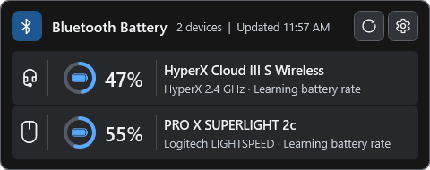
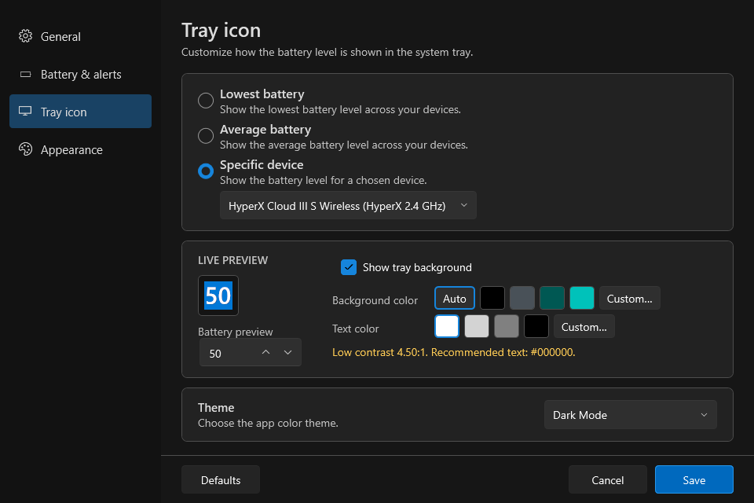

# Bluetooth Battery Monitor

Bluetooth Battery Monitor is a Windows tray app for checking the battery levels of supported Bluetooth and wireless devices. A compact popup shows each device, its battery level, connection source, and an estimated charging or usage rate when enough data is available.

<p align="center">
  
</p>

_The devices and battery values in the screenshots are sample data._

## Download

Download `BluetoothBatteryMonitor-Setup.exe` from the [GitHub Releases page](https://github.com/jeremygold02/bluetooth-battery-monitor/releases/latest) and run it to install the app for your Windows account. The release also includes `BluetoothBatteryMonitor.exe` if you prefer a portable copy, plus separate third-party license notices.

The app runs on Windows 10 or Windows 11 and needs no separate runtime. The portable `BluetoothBatteryMonitor.exe` replaces itself with the native app the first time it starts; that one-time step uses .NET Framework 4.8, which is included with current Windows versions. Existing 0.1.x copies update to the native app automatically.

## Features

- Show supported device battery levels in a compact tray popup, with details available on hover.
- Choose the lowest battery, average battery, or a specific device for the tray icon.
- Estimate charging and discharge rates from observed battery-level changes, with separate rolling histories for charging and usage.
- Customize the tray icon background and text colors, theme, notification thresholds, popup details, refresh interval, and Windows startup behavior.
- Refresh manually or automatically, including after a Bluetooth LE connection or disconnection.
- Install available updates automatically at startup, waiting for unsaved settings to be saved or closed before restarting. Update failures are reported; you can also check manually from Settings or the tray menu.

## Supported devices

The monitor combines local Windows and device-protocol sources:

- The Windows `System.Devices.BatteryLife` property and Bluetooth LE Battery Service, including charging state when a device reports it.
- Logitech HID++ battery features `0x1000` and `0x1004`, used by compatible LIGHTSPEED receivers.
- The PRO X3 SUPERSTRIKE LIGHTSPEED receiver (`046D:C54F`), using its 20-byte HID++ interface; physical-device validation is pending.
- HyperX Cloud III S Wireless dongle battery and charging-state responses for HP USB product IDs `02CC` and `06BE`.

The current collectors have been verified with a Logitech G305 LIGHTSPEED mouse and a HyperX Cloud III S Wireless headset. Other devices can work when they expose a supported Windows, Bluetooth, or HID battery interface; detection and available details vary by device.

Readings from different sources are merged when they identify the same device unambiguously. Devices with duplicate names from the same source remain separate. The popup lists known battery levels first, with the lowest level at the top.

## Refresh and battery estimates

The app checks devices at startup and at the interval selected in Settings, every 60 seconds by default. It also requests a check after a Bluetooth LE device connects or disconnects. Battery changes and USB receiver devices still use polling or manual refresh.

An initial rate needs at least three readings over 30 minutes and a change of at least three percentage points. Devices that report in coarse steps can take longer. Once learned, charging and discharge rates are kept separately as duration-weighted rolling averages of the latest 20 qualifying periods for each device. The learned rates are saved locally and can be reused after the app restarts; new observations gradually replace older periods.

Rates and time remaining are estimates based on past percentage changes, not electrical current measurements. They can change with use, charging conditions, battery aging, and the precision of a device's battery gauge. When the current direction is unknown, a saved usage rate is shown as an average without a live time-remaining prediction.

Cached and unavailable readings do not contribute to the estimate. An interrupted observation—such as a device disappearing, a long gap, a charge-state change, or Windows resuming—starts a fresh observation period while retaining qualified history. Windows may also expose a cached battery property without indicating how recently the hardware measured it.

## Using the tray app

- Left-click the tray icon to open or close the popup. Use its refresh button or **Refresh now** in the tray menu to check immediately.
- Open Settings from the popup gear or tray menu. A specific-device selection changes the tray icon; the popup can still show the other devices.
- Hover over a device for labeled battery, source, status, and rate details. Scroll the list when more devices are present than fit in the popup.
- A sleeping, disconnected, or unavailable device can show its last successful battery value, labeled as a cached reading. The app saves these readings locally so they remain available after a restart.



## Development

The app is written in Rust. Building from source requires Windows and the stable Rust toolchain for `x86_64-pc-windows-msvc`.

From PowerShell in the project folder:

```powershell
cargo build --release
```

The app is written to `target\release\BluetoothBatteryMonitor.exe`. Only one instance runs at a time, so exit an existing tray instance before starting a local build. Local builds report version `0.0.0` and do not check for updates automatically.

Run the automated checks without showing app windows:

```powershell
cargo test
```

Release builds also publish a small .NET Framework bridge under the name `BluetoothBatteryMonitor.exe`. The 0.1.x updater accepts only that file; when started, it puts the native app in its own place. Building and testing it requires the .NET 8 SDK or later:

```powershell
dotnet build .\bridge\BluetoothBatteryMonitor.csproj -c Release --artifacts-path .\artifacts\bridge -p:BridgeVersion=99.0.0
.\bridge\tests\run-migration-test.ps1 -Bridge .\artifacts\bridge\bin\BluetoothBatteryMonitor\release\BluetoothBatteryMonitor.exe -NativeExecutable .\target\release\BluetoothBatteryMonitor.exe -Version 99.0.0
```

The migration test runs the released 0.1.0 and 0.1.7 updater code from `bridge\legacy` against the bridge in a temporary folder and checks the update, the rollback after a failed start, and a manual start.

To collect the license notices that ship with a release into `artifacts\build`:

```powershell
.\tools\collect-licenses.ps1 -Destination .\artifacts\build
```

For a direct local device-collector check:

```powershell
powershell -ExecutionPolicy Bypass -File .\tools\run-battery-collectors-probe.ps1
```

## Troubleshooting

- **HyperX is missing:** turn on the headset, reconnect its USB dongle, and refresh. The dongle reports `0xFF` when the headset is unavailable.
- **G305 is missing:** wake the mouse and refresh. HID++ queries may not answer while it is asleep.
- **A Bluetooth device is missing:** confirm Windows can display its battery level. Not every device implements the standard Battery Service or exposes a Windows battery property.
- **A selected device is unavailable:** reconnect or wake it. If its connection or receiver changes, its identifier can change and it may need to be selected again.
- **A local build exits immediately or cannot be rebuilt:** exit the existing tray process first.

## Privacy

Device readings are collected locally. Preferences, last-known battery readings, and learned rate samples, keyed by device identifier, are stored in `%APPDATA%\BluetoothBatteryMonitor\settings.json`. The app contacts GitHub for release checks and update downloads; it has no separate telemetry or analytics service.

## Attribution

The interface uses [egui](https://github.com/emilk/egui). The HyperX protocol compatibility work was informed by the MIT-licensed [HyperHeadset](https://github.com/LennardKittner/HyperHeadset) and [HyperX Cloud 2 Battery Monitor](https://github.com/auto94/HyperX-Cloud-2-Battery-Monitor) projects. License notices are included in `THIRD_PARTY_NOTICES.md` and the build output.

This project builds on [Codex Usage Tray](https://github.com/jeremygold02/codex-usage-tray-icon), which was inspired by the commercial [Bluetooth Battery Monitor](https://www.bluetoothgoodies.com/). It contains no code from that commercial application.
